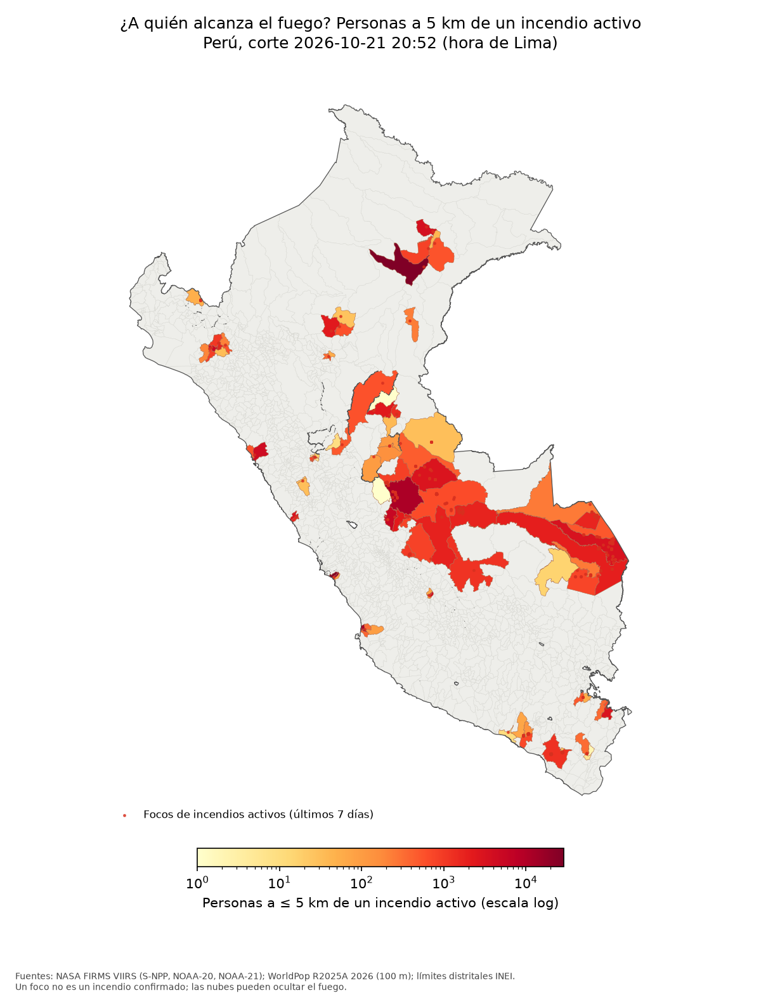

# ¿A quién alcanza el fuego? Incendios en el Perú al 21 de octubre de 2026

**Autor:** Rodrigo Norabuena. Curso Ciencia de Datos con Python, Universidad del Pacífico, 21 de octubre de 2026.

**Dashboard:** [¿A quién alcanza el fuego?](https://claude.ai/artifact/L7bWfwPE94wdHdTsXhLNcy), un relato con mapa que cruza los focos de calor con la población y las edificaciones.

## Pregunta

¿Cuántas personas y edificaciones están a menos de X km de un incendio activo al 21 de octubre de 2026? ¿En qué distritos? ¿Cuánto cambia esa cifra según el radio (1, 2, 5 o 10 km) y según la fuente (WorldPop frente a Google Open Buildings)?

## Datos y fechas

| Dato | Versión y fecha | Fuente |
|---|---|---|
| Focos de calor VIIRS 375 m (S-NPP, NOAA-20, NOAA-21) | NRT, 1 jul – 21 oct 2026. Corte: **2026-10-22 01:52 UTC (21 oct, 20:52 hora de Lima)** | NASA FIRMS, Area API: `https://firms.modaps.eosdis.nasa.gov/api/area/` |
| Límites distritales (1873 distritos, INEI) | Shapefile `DISTRITOS.shp` del curso | Hugging Face, dataset `aquiro1994/ds-python-up`, `_data/Folium/` |
| Población (raster) | WorldPop R2025A, año 2026, 100 m, *constrained* | `https://data.worldpop.org/GIS/Population/Global_2015_2030/R2025A/2026/PER/v1/100m/constrained/per_pop_2026_CN_100m_R2025A_v1.tif` |
| Edificaciones | Google Open Buildings v3 (polígonos con confianza ≥ 0,75), leído del espejo GeoParquet de VIDA | `https://data.source.coop/vida/google-microsoft-open-buildings/geoparquet/by_country_s2/country_iso=PER/` |
| Relieve | AWS Terrain Tiles (Terrarium), zoom 8 | `https://s3.amazonaws.com/elevation-tiles-prod/terrarium/{z}/{x}/{y}.png` |

Los focos se bajan en bloques de 5 días por satélite (69 consultas). La API devuelve, para `/{N}/{FECHA}`, los datos de FECHA a FECHA + N − 1 (lo verificamos con `acq_date`), así que los bloques no se solapan. Además, se eliminan duplicados.

Para Open Buildings se midieron primero los tamaños. Los archivos CSV por celda S2 nivel 4 pesan de 100 a 190 MB cada uno. El espejo GeoParquet trae un `bbox` por fila con estadísticas por grupo de filas, y DuckDB solo lee los grupos que tocan cada zona. Por eso se eligió esa ruta (solo filas `bf_source = 'google'`).

## Método

1. **Limpieza de focos** (de 199 399 detecciones en el recuadro):
   - fuera del Perú: 64 405;
   - confianza baja (`confidence = l`): 10 413;
   - a ≤ 3 km de los volcanes Sabancaya, Ubinas, Misti, Ticsani, Huaynaputina y Yucamane: 53;
   - píxeles persistentes, es decir, la misma celda de ~375 m detectada en ≥ 10 días distintos a lo largo de ≥ 60 días (quemas de gas, fundiciones): 948 focos en 35 celdas.
   - Quedan **123 580 focos** en la temporada.
2. **Incendios:** se unen los focos a ≤ 1 km y ≤ 48 h (BallTree haversine y componentes conexas). Un incendio está **activo** si tiene un foco en las 24 h anteriores al corte. La huella es el número de píxeles únicos de ~375 m × 14,06 ha (no es área quemada).
3. **Filtro urbano y de fuentes fijas.** Un foco dentro de una ciudad suele ser industria, un botadero o calor urbano, no vegetación. Un incendio activo se marca y se excluye de la exposición, del ranking de distritos y de la prioridad si cumple alguna de estas condiciones:
   - **Urbano:** ≥ 5000 personas a 1 km de sus focos (≈ 1600 hab/km² en un círculo de 3,14 km²), o un foco en una celda de ~1 km con ≥ 1500 hab/km². Este es el umbral de "centro urbano" del *Degree of Urbanisation* (Eurostat / Comisión de Estadística de la ONU, 2020).
   - **Fuente fija o recurrente:** un incendio pequeño (≤ 2 focos, sin frente que avance) en un lugar que ya tuvo detecciones a ≤ 500 m al menos 30 días antes. La vegetación rara vez vuelve a arder en el mismo sitio un mes después; las plantas industriales, los botaderos y los hornos, sí.
   - Resultado: de 154 incendios activos se marcan 32 (1 urbano y 31 de fuente fija). Quedan **122 incendios activos de vegetación**.
4. **Exposición** para r = 1, 2, 5 y 10 km:
   - se toma un buffer de los focos de las últimas 48 h de cada incendio activo no marcado, en la proyección de área igual ESRI:102033;
   - los buffers se disuelven para no contar dos veces y se intersecan con los distritos;
   - personas = suma de WorldPop 2026 a 100 m dentro de la zona; edificaciones = número de polígonos de Open Buildings dentro de la zona.
   - Se usan solo las últimas 48 h porque muchos grupos de focos siguen "vivos" durante meses encadenando detecciones; usar toda su historia inflaría la exposición.
5. **Triangulación:** edificaciones × 3,5 personas por vivienda. Es una cifra de referencia del promedio de personas por hogar del Censo 2017 del INEI, pendiente de verificar. Se compara con WorldPop.
6. **Prioridad (0–100)** por incendio activo:
   `prioridad = 100 × (0,35·n(log(1 + personas a 5 km)) + 0,25·n(huella en ha) + 0,20·n(FRP total en 24 h) + 0,20·n(focos en 24 h))`, donde n() es la normalización mín–máx entre los incendios activos no marcados.
7. **Caso de estudio:** el incendio activo de vegetación (≥ 3 focos, huella ≥ 50 ha, sin marca) con más personas a 5 km. Para ese incendio se calcula, con `cKDTree` en metros, la distancia de cada edificación al foco más cercano.

## 3 hallazgos con números

1. **El radio cambia la respuesta.** Al corte había 122 incendios activos de vegetación. A 5 km de sus focos viven unas **206 740 personas** (WorldPop 2026). Con 1 km son 5838 y con 10 km, 938 478: el radio elegido multiplica la cifra por 161. Aparte quedan 32 incendios marcados como urbanos o de fuente fija, que habrían sumado 187 759 personas más a 5 km.
2. **Nauta concentra la exposición.** El distrito de Nauta (Loreto) reúne **28 841 personas** a 5 km de un incendio activo, el 14 % del total nacional. Los 10 primeros distritos suman el 68 %.
3. **Dos fuentes que no coinciden del todo.** Open Buildings cuenta **118 358 edificaciones** a 5 km. Con 3,5 personas por vivienda serían 414 253 personas, frente a 206 740 según WorldPop, es decir, 1,7 personas por edificación: no toda edificación es una vivienda. En el caso de estudio (Puerto Bermúdez, Oxapampa, Pasco: 5 focos, 70 ha de huella, 4073 personas a 5 km), la edificación más cercana está a **484 m** de un foco.

Las cifras salen de `outputs/hallazgos.json` y de `web/data/summary.json`.

## Mapa



## Limitaciones

- **Un foco no es un incendio.** Es un píxel más caliente que su entorno. Puede ser una quema agrícola, una industria o un botadero. El filtro urbano y de fuentes fijas es una regla aproximada: puede dejar falsos positivos (por ejemplo, focos aislados en el desierto costero cerca de Lima o de Pisco) y quitar algunas quemas reales de chacras que vuelven a arder.
- **Las nubes esconden el fuego.** Si un incendio está bajo nubes al paso del satélite, no se detecta, y en la selva la nubosidad es frecuente.
- **Píxeles de 375 m.** La posición tiene una incertidumbre de cientos de metros, y un incendio pequeño puede ocupar solo una parte del píxel.
- **La huella no es área quemada.** Es el número de píxeles detectados × 14,06 ha.
- **WorldPop es un modelo.** Reparte la población proyectada según imágenes y covariables, no es un censo.
- **Open Buildings** depende de la detección automática y del umbral de confianza (≥ 0,75). Cuenta edificaciones, no viviendas, y las imágenes de base pueden tener años de antigüedad.
- **Un radio no es una zona de evacuación.** La distancia en línea recta no considera el viento, la pendiente, los ríos ni los caminos.
- **Hora de corte.** Las cifras corresponden al 21 de octubre de 2026 a las 20:52 (hora de Lima). Con cada paso de satélite cambian.

## Cómo reproducir

```bash
uv sync
cp .env.example .env    # y pegar la clave: FIRMS_MAP_KEY=...
uv run python -m pipeline.run_all
```

Las descargas quedan en `data/raw/` (no se versiona) y cada paso reutiliza lo que ya existe. Para un corte nuevo, borrar `data/raw/firms/` y `data/interim/`.

## Dashboard

[¿A quién alcanza el fuego?](https://claude.ai/artifact/L7bWfwPE94wdHdTsXhLNcy) cuenta el hallazgo en siete pasos: la temporada completa, el fuego de hoy, dónde vive la gente, los distritos donde se cruzan, el efecto del radio y las casas junto a un incendio. Después viene un explorador por incendio y distrito, y una tabla que se puede copiar en CSV.

La página está en `web/index.html` y lee los archivos de `web/data/` y `web/assets/`, que genera el pipeline. Para verla en local:

```bash
uv run python -m http.server 8000 --directory web
```

Usa deck.gl 9.0.38 y topojson-client 3.1.0 desde CDN.
